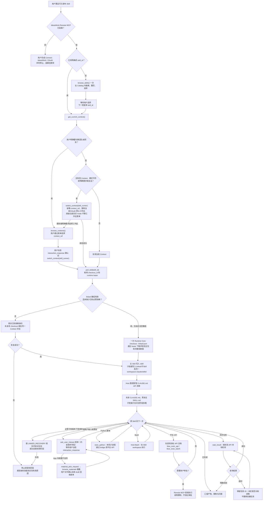

# Codex Plugin Runner 主链路

本图描述已发布 Skill 在 **Codex Plugin + Remote MCP + 本地 Runtime Core** 中的运行流程；
独立终端 CLI 的 `ideaswork skill pull` 是另一条入口，见 [CLI_BINDING.md](CLI_BINDING.md)。图中的 `checkout` 指用
`checkout_id` 下载并物化 ZIP，不是 Git checkout，也不是 SHA-256 校验。

- 主 Skill 的 `checkout` 写入 `.avp_run/<主Skill名>/skill/` 和
  `.avp_run/<主Skill名>/workspace/.claude/skills/<主Skill名>/`。
  linked 子技能通过 `--primary-skill-name <主Skill名>` 共享这个 workspace，
  写入 `.avp_run/<主Skill名>/linked/<子技能名>/` 和同一 workspace 下的
  `.claude/skills/<子技能名>/`；不创建子技能自己的 `.avp_run` 目录。
- 只有需要发现 Skill 时才调用 Catalog。初始化或仅切 mode 不弹工作区表单；只有用户明确换工作区，
  或服务端确认默认工作区不可用时才查询候选并让用户选择。原 Context 丢失时恢复原工作区，不静默改用默认项目。
  仅在 Context 初始化、模式不符或明确切换等条件下调用 `switch_context`；
  `pull_skill` 已提供 lease，只有失效、额度耗尽或 Context 变化才重签。
- linked 子技能、用户交互、审批拒绝、脚本及异步等待均为按需分支。Runtime Core 的
  lease 恢复只重试尚未完成的步骤；Python 脚本可能已产生副作用，须先核对状态，不能盲目重跑。
- checkout 负责归档落盘；受管 `CLAUDE.md`、linked prompt 与 API 清单的整理仍是后续
  Host 步骤，不能把它误认为第二次下载。

- 缺失的必需子技能先按 [LINKED_RECOVERY.md](LINKED_RECOVERY.md) 核实并尝试补拉；
  只有恢复失败才停止受影响阶段并报告实际原因。已随主 pull 下发的 checkout 不重复 pull。
